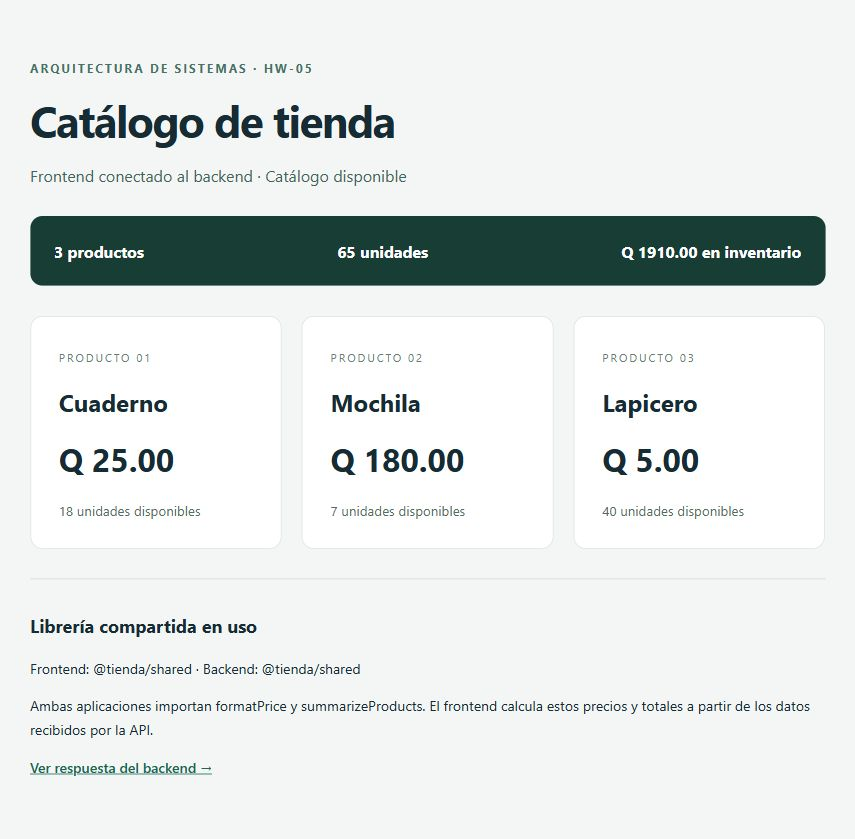
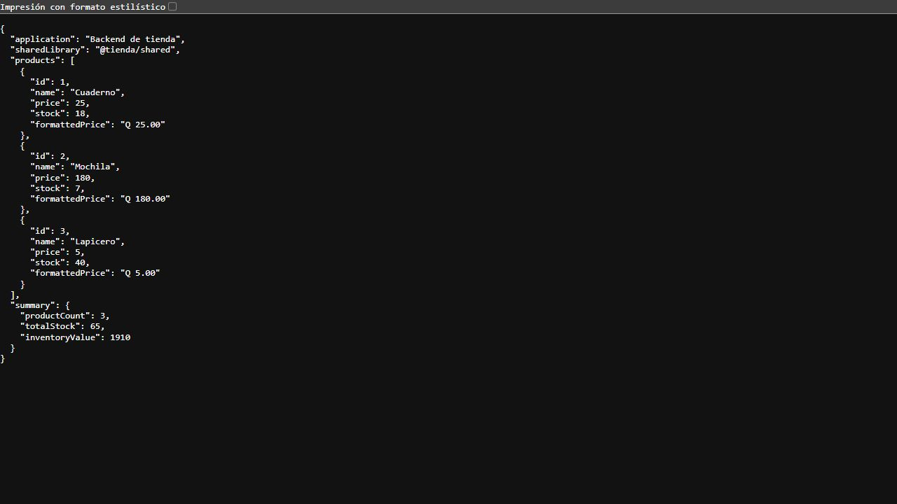

# Arquitectura de Sistemas — HW-05

Monorepo de una tienda con dos aplicaciones y una librería compartida, administrado con **Turborepo y npm workspaces**.

- Repositorio del curso: https://github.com/Daniielvf/ARQUITECTURA_MONOREPO
- Rama de evaluación: [`hw-05`](https://github.com/Daniielvf/ARQUITECTURA_MONOREPO/tree/hw-05), creada desde `main` después del commit inicial.

## Estructura

```text
apps/
  frontend/           # Interfaz web con JavaScript y Vite
    src/              # Consulta de API, presentación y estilos
    test/             # Pruebas de transformación del catálogo
  backend/            # API HTTP con Node.js
    src/              # Servidor y rutas
    test/             # Pruebas HTTP con un servidor real en puerto temporal
packages/
  shared/             # @tienda/shared: datos y utilidades reutilizables
    src/
    test/
docs/
  screenshots/        # Capturas reales de ambas aplicaciones funcionando
package.json          # Workspaces y comandos para todo el monorepo
package-lock.json     # Versiones reproducibles de las dependencias
turbo.json            # Dependencias entre tareas y caché
```

## Herramienta elegida

Turborepo coordina los comandos de los tres paquetes, ejecuta tareas independientes en paralelo y reutiliza resultados de compilación mediante caché. Se eligió porque permite mantener aplicaciones y código compartido en un mismo repositorio sin duplicar la configuración de ejecución.

npm workspaces instala y enlaza los paquetes locales. Las aplicaciones declaran `@tienda/shared` como dependencia. Turborepo reconoce esa relación y compila primero la librería mediante `dependsOn: ["^build"]`. Las salidas `dist/**` se almacenan en caché; los servidores de desarrollo son tareas persistentes sin caché.

## Ejecutar desde cero

Requisitos: Git, Node.js **22.12 o posterior** y npm **11.17.0**. Validado con Node.js 24.19.0 y npm 11.17.0.

```bash
git clone https://github.com/Daniielvf/ARQUITECTURA_MONOREPO.git
cd ARQUITECTURA_MONOREPO
git switch hw-05
npm ci
npm run dev
```

Abrir:

- Frontend: http://127.0.0.1:5173
- Backend (catálogo JSON): http://127.0.0.1:3001/api/products
- Estado del backend: http://127.0.0.1:3001/api/health

`npm run dev` compila primero la librería y arranca ambas aplicaciones. Detener con `Ctrl+C`. Los puertos 5173 y 3001 deben estar libres.

Para ejecutar cada aplicación por separado, usar dos terminales desde la raíz:

```bash
# Terminal 1
npm run dev:backend
```

```bash
# Terminal 2
npm run dev:frontend
```

El backend funciona de manera independiente. El frontend puede iniciar solo, pero necesita el backend para mostrar el catálogo; si no está disponible, presenta un mensaje de error. Vite redirige `/api` al backend mediante un proxy.

Si se modifica `packages/shared/src/index.js` durante el desarrollo, detener los servidores y volver a ejecutar `npm run dev` para recompilar la librería.

## Comandos desde la raíz

| Comando | Función |
| --- | --- |
| `npm ci` | Instalar todos los workspaces respetando el archivo de bloqueo |
| `npm install` | Instalar dependencias y actualizar el bloqueo al cambiar paquetes |
| `npm run dev` | Ejecutar frontend y backend en desarrollo |
| `npm run dev:frontend` | Ejecutar únicamente el frontend y compilar su dependencia compartida |
| `npm run dev:backend` | Ejecutar únicamente el backend y compilar su dependencia compartida |
| `npm run build` | Compilar la librería y ambas aplicaciones |
| `npm run build:frontend` | Compilar frontend y librería compartida |
| `npm run build:backend` | Compilar backend y librería compartida |
| `npm test` | Ejecutar las pruebas de los tres paquetes |
| `npm run test:frontend` | Probar la transformación de datos del frontend |
| `npm run test:backend` | Probar la API HTTP |
| `npm start` | Compilar y ejecutar las aplicaciones compiladas en vista previa local |

Para comprobar las compilaciones:

```bash
npm run build
npm test
npm start
```

Detener previamente los servidores de desarrollo: la vista previa utiliza los mismos puertos. `npm start` sirve para verificar el resultado localmente; el frontend usa `vite preview`.

## Uso real de la librería compartida

`packages/shared` exporta:

- `products`: catálogo de ejemplo.
- `formatPrice`: valida el precio y lo presenta en quetzales con dos decimales.
- `summarizeProducts`: calcula cantidad de productos, existencias y valor del inventario.
- `LIBRARY_NAME`: identifica el paquete en las evidencias.

El backend importa estas utilidades en `apps/backend/src/app.js`. `GET /api/products` devuelve los productos, los precios formateados y el resumen calculado.

El frontend importa las mismas utilidades en `apps/frontend/src/catalog.js` y vuelve a calcular los precios y el resumen a partir de los datos numéricos de la API. No se limita a mostrar el texto calculado por el backend. Ambas aplicaciones declaran la dependencia en su propio `package.json`.

El ejemplo muestra 3 productos, 65 unidades y **Q 1910.00** de inventario. Su alcance es un catálogo de demostración en memoria; no requiere base de datos, credenciales ni variables de entorno.

## Pruebas

Las cinco pruebas automatizadas usan `node:test`:

- Librería: formato monetario, rechazo de precios inválidos y resumen de inventario, incluido el catálogo vacío.
- Backend: respuesta real de `/api/products`, datos calculados, estado de salud, ruta inexistente (404) y método no permitido (405).
- Frontend: cálculo propio de precios y totales desde datos de la API y manejo de catálogo vacío.

La compilación de los tres paquetes y las cinco pruebas se verificaron satisfactoriamente. También se comprobó en el navegador la comunicación del frontend con el backend.

## Capturas de pantalla

Capturas reales tomadas con ambas aplicaciones iniciadas mediante `npm run dev`.

### Frontend

El catálogo muestra los precios y el resumen calculados con `@tienda/shared`, además de la identificación de la librería utilizada por cada aplicación.



### Backend

Respuesta JSON de `http://127.0.0.1:3001/api/products`: incluye `sharedLibrary`, `formattedPrice` y `summary`, producidos usando la librería compartida.



## Historial de commits

Se usa Conventional Commits: `tipo(alcance opcional): descripción`. El historial separa la inicialización, la configuración, la librería, las aplicaciones y la documentación.

```bash
git log --oneline --all --graph
```

`main` conserva la base inicial; la implementación de esta evaluación se encuentra en `hw-05`.

## Referencias

- [Turborepo: configuración de tareas](https://turborepo.com/docs/crafting-your-repository/configuring-tasks)
- [npm workspaces](https://docs.npmjs.com/cli/v11/using-npm/workspaces)
- [Conventional Commits](https://www.conventionalcommits.org/en/v1.0.0/)
